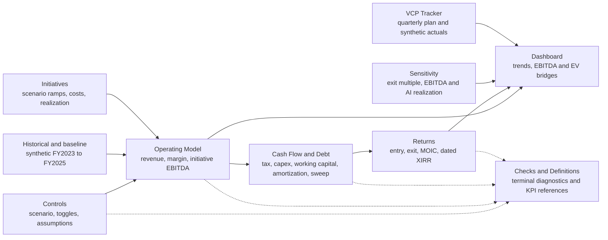

# Workbook calculation flow

All names, data and outcomes in the diagrams and workbook are synthetic and illustrative.

**Legend:** solid arrows show formula dependencies. Dashed arrows show read-only checks. Checks are terminal diagnostics and do not feed assumptions, operating calculations or outputs.

The workbook uses one active scenario selector. The operating model and cash flow schedule recalculate when the selector changes. The return sensitivities use visible formula grids. The AI realization grid has a separate visible calculation block that recalculates annual taxes, debt paydown and retained cash for each realization point.
