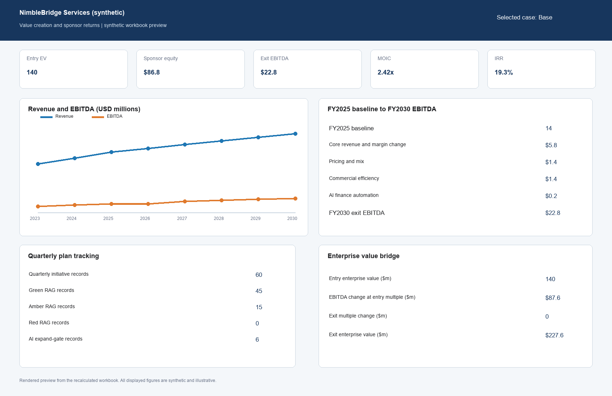
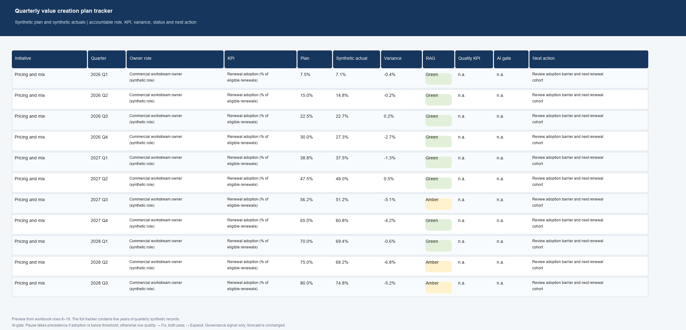

# Synthetic value creation case

## Page 1. Investment question and operating plan

### Investment question

How could operating initiatives change earnings, cash generation, debt paydown and sponsor returns over a five-year hold?

### Company and baseline

NimbleBridge Services is a synthetic B2B services company. Its illustrative FY2025 baseline is $100.0 million of revenue and $14.0 million of EBITDA. The forecast covers 2026–2030. No company records, market diligence or operating data were used.

### Initiatives

| Initiative | Base-case logic | Main execution risk |
|---|---|---|
| Pricing and mix | ($2.4m gross contribution − $0.6m churn offset) × adoption ramp × 80% realization. | Renewal adoption or churn misses the illustrative guardrail. |
| Commercial efficiency | $1.8m annual savings × adoption ramp × 75% realization. | Savings lack a validated spend baseline or accountable cost owners. |
| AI finance automation | 18,000 addressable hours × $52 loaded cost × 70% avoidable share × adoption ramp × 65% realization, less implementation and run costs. | Adoption, output quality or avoidable-cost evidence falls short. |

All assumptions and outcomes are synthetic. Redeployed AI capacity is not treated as EBITDA. The AI estimate counts only avoided hiring or contractor cost. One case selector feeds one forecast and debt schedule; interest uses opening debt to avoid circularity. Entry and exit fees are shown separately.

<!-- PAGE BREAK -->

## Page 2. Returns, execution and decision

### Dashboard and returns

| Case | Entry equity ($m) | Exit EBITDA ($m) | Exit multiple | Exit equity ($m) | MOIC | IRR |
|---|---:|---:|---:|---:|---:|---:|
| Base | 86.80 | 22.76 | 10.0x | 210.09 | 2.4204x | 19.33% |
| Downside | 86.80 | 17.24 | 8.5x | 116.76 | 1.3451x | 6.11% |
| Upside | 86.80 | 25.67 | 11.0x | 271.72 | 3.1305x | 25.62% |

### EBITDA and enterprise-value bridge

Base EBITDA: **$14.00m entry EBITDA + $5.84m core growth and margin + $1.39m pricing + $1.35m commercial efficiency + $0.18m AI = $22.76m exit EBITDA.** At the 10.0x entry multiple, the EV bridge is **$140.00m entry EV + $87.59m EBITDA change at entry multiple + $0.00m multiple effect = $227.59m exit EV.**

### Sensitivity and worked pricing example

At Base, changing the exit multiple from 10.0x to 9.0x / 11.0x changes MOIC from **2.4204x** to **2.1609x / 2.6800x**, and IRR from **19.33%** to **16.65% / 21.78%**.

Increasing Base pricing realization from 80% to 90% raises Year 1 contribution before costs from $0.432m to $0.486m and net Year 1 contribution from $0.032m to $0.086m. Recalculated Base returns move from **2.4204x MOIC and 19.33% IRR** to **2.4473x and 19.59%**.

### Quarterly execution and AI gate

The tracker compares quarterly plan with synthetic actuals and shows variance, RAG status and next action. For AI, the row 48 formula is `=IF(H48<Controls!$D$39,"Pause",IF(K48<Controls!$D$40,"Fix","Expand"))`: adoption below 60% means Pause; otherwise quality below 98% means Fix; otherwise Expand. **Pause takes precedence when both conditions fail. Expand / Fix / Pause is a governance signal only; it does not change the forecast.**

### AI lever economics and decision

Over the five-year hold, modeled net AI EBITDA contribution totals **−$0.44m**, including one-off implementation and annual run costs. The 2030 net run-rate contribution is **$0.18m × 10.0x = $1.83m** of implied exit enterprise value before fees and debt. The one-off implementation cost remains in reported EBITDA rather than being added back, a conservative view versus adjusted EBITDA.

**Illustrative decision:** Base IRR of 19.33% falls just short of an illustrative 20% hurdle. Core growth and margin supply about two-thirds of the $8.76m EBITDA increase ($5.84m); the three initiatives supply about one-third ($2.92m), of which AI is only $0.18m. Closing the gap needs roughly $0.6m more exit EBITDA or about 0.26x on the exit multiple (approximate, from the Base equity bridge). The decision this supports: proceed only if diligence can evidence the core growth plan; the initiatives improve returns but cannot carry the case on their own.

**Downside check:** in Downside the AI lever is net negative (about −$0.08m in 2030) because run costs exceed realized savings. Turning it off lifts Downside MOIC from 1.35x to 1.37x and IRR from 6.1% to 6.5% – the case for the Pause gate, and a reminder to model a pause as a toggle, not only a tracker signal.

### Risks shown in the model

- Pricing adoption or churn misses plan: review the Pricing and mix KPI, plan-versus-actual variance and realization input on **VCP Tracker** and **Initiatives**.
- Commercial savings are not validated: compare the synthetic savings KPI and target in **VCP Tracker** with its named owner and dependency.
- AI adoption or output quality fails its gate: check the adoption and quality KPIs and threshold controls. The gate does not remove AI from the forecast, so a pause decision requires a separate scenario or toggle change.
- Leverage, cash conversion or exit valuation differs from assumptions: inspect the debt and cash schedule and the two formula grids on **Sensitivity**.

### Limitations

- Annual periods only; quarterly tracker actuals are seeded, not forecast drivers.
- Interest is charged on opening debt to avoid circular formulas; no refinancing, revolver or interim distributions.
- Single exit at year 5 on an EBITDA multiple; no dividend recap, earn-out or management equity.
- The AI gate is a governance signal and does not change the forecast unless the toggle is switched.

All values and quarterly actuals are synthetic. The model contains no market research, diligence validation, company operating data, financing commitment or realized savings. Tax, working-capital, fee and debt assumptions are illustrative, not advice or an investment recommendation.
